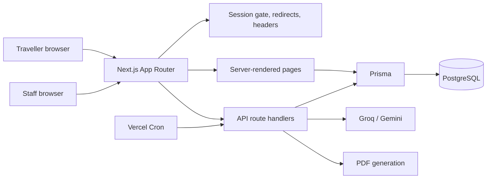

# Itera

**A travel-package publishing and enquiry operations platform for a Kerala and
South India tour operator.**

Itera brings public package discovery, staff-managed package content, traveller
enquiries and AI-assisted response drafting into one application. It addresses
two practical workflow problems: package changes that depend on developer
support, and enquiry details that otherwise need to be manually transferred
between channels and staff.

| | |
|---|---|
| **Live application** | [itera-5nq4.vercel.app](https://itera-5nq4.vercel.app/) |
| **Source repository** | [vaishnavi-eklaspur/itera](https://github.com/vaishnavi-eklaspur/itera) |
| **Technical design document** | [TDD.pdf](TDD.pdf) |
| **Local and Vercel setup** | [deployment.md](deployment.md) |

## At a glance

- **Core build:** public package search and detail pages; an authenticated,
  versioned package CMS; enquiry capture; and an assignment-aware staff inbox
  for reviewing, correcting and responding to enquiries.
- **AI assistance:** provider-based extraction, deterministic package matching
  and an editable draft reply. AI output is advisory; it is not an automatic
  booking or a sent staff reply.
- **Additional depth:** blog CMS, quotes and branded PDFs, analytics, activity
  history, consent/data-rights workflows, scheduled publishing and SEO routes.
- **External services:** email dispatch and other outside-system actions are
  mocked or represented as staff workflows where applicable; they do not
  indicate a real delivery, payment or booking.

The distinction matters: the assignment's **Core Build** defines the required
product slice. Its **Smart Touches** and the additional features in this
repository are implementation depth, not a claim that every optional item in
the broader brief was mandatory.

## Main workflows

### Package discovery and publishing

Travellers search published packages by destination, duration, budget,
season and hotel tier, then view itinerary, inclusions, exclusions, photos,
map and seasonal prices. Admin and Consultant users can manage package
content. Edits are saved as versions; staged seasonal prices and content are
activated together when staff publishes or a scheduled publish becomes due.
Preview and restore actions do not overwrite the current version.

### Enquiry to staff response

The package enquiry form validates input and privacy consent, stores the
original message and structured fields, and triggers automatic AI extraction.
The inbox shows the source message beside extracted fields, package matches
and a draft reply. Staff can assign, annotate, correct and reply. The
acknowledgement implementation logs a fixed-template message; it is not wired
to a live email provider.

### AI workflow and verification boundary

Groq is tried first when configured, with Gemini as a fallback. Provider
output is parsed and validated against a Zod schema. Package suggestions are
ranked in application code against published packages, dates, party size,
budget, season and trip requirements. Provider errors take a deterministic
fallback path so enquiry intake remains available; staff review is required
before the draft reply is sent.

**Production AI verification is partial, not complete.** A synthetic
production enquiry returned HTTP 200 and was persisted in Neon, including
dates, traveller counts, budget and a draft reply. The persisted destination
was null and package suggestions were empty. Provider keys were confirmed
configured, but historical runtime logs were unavailable to diagnose that
provider-level result. A malformed JSON request was verified to return HTTP
400. See [TDD.pdf](TDD.pdf) for evidence and limitations.

## Technology and architecture

| Layer | Implementation | Why it fits this product |
|---|---|---|
| Web application | Next.js 16 App Router, React 19, TypeScript | Server-rendered public routes, metadata and API handlers in one deployable application |
| Data | PostgreSQL, Prisma 6 | Relational package/enquiry workflows, typed queries and transactional publishing |
| Identity | NextAuth credentials, bcryptjs, role checks | Staff and traveller sessions without a separate identity service for the demo |
| Input safety | Zod | Shared, explicit validation at form and API boundaries |
| Interface | Tailwind CSS 4, Lucide | Consistent responsive visual language with a small component footprint |
| AI providers | Groq, Gemini fallback | Structured extraction behind a server-side provider boundary |
| Documents and maps | `pdf-lib`, Leaflet/OpenStreetMap | Branded quote PDFs and itinerary geography without a paid maps SDK |
| Hosting | Vercel; PostgreSQL hosted on Neon for production | Direct Next.js deployment and managed relational database |
| Tests | Vitest | Focused tests for API behavior, business rules and failure paths |



The schema separates stable package identity from authored package versions,
and stores seasonal prices as queryable relational rows. Enquiries retain
source text and staff workflow state while AI results are separate JSON fields.
This keeps generated suggestions distinguishable from original customer
input.

## Roles and safeguards

The application defines **Admin, Editor, Consultant and Traveller** roles.
Access is checked in the request proxy and again in protected pages or API
handlers. Admin has broad management access; Editor focuses on editorial
content; Consultant handles package and enquiry work; Traveller access is
limited to their own account and enquiries.

Implemented safeguards include bcrypt password hashes, JWT-backed sessions,
server-side role checks, Zod input validation, parameterized Prisma queries,
internal AI/cron secrets, IP-based rate limiting, consent provenance,
data-rights requests and security response headers. The rate limiter is
process-memory based and is not a distributed enforcement mechanism.

## Run locally

Requirements: Node.js 20.9 or newer, npm and PostgreSQL. From PowerShell:

```powershell
git clone https://github.com/vaishnavi-eklaspur/itera.git
Set-Location itera
npm ci
Copy-Item .env.example .env
# Add local values to .env; see deployment.md for the variable list.
npx prisma db push
npm run db:seed
npm run dev
```

Open [http://localhost:3000](http://localhost:3000). The current project setup
uses `prisma db push` to synchronize the schema; see [deployment.md](deployment.md)
before choosing a production database workflow.

## Verification

The production image-loading changes were deployed in commit
`4c58cbbeb3db0e9e42aa53358b2a5420bca935cf`. On the deployed site, Lighthouse
13.6.0 was run with the mobile Slow 4G profile (150 ms RTT, 1638.4 Kbps,
4× CPU slowdown, 412×823 viewport):

| Production route | Baseline LCP | Latest LCP | Change |
|---|---:|---:|---:|
| Homepage | 5.735 s | 4.953 s | Improved |
| Packages | 3.144 s | 2.518 s | Improved; 18 ms above 2.5 s |
| Munnar detail | 4.566 s | 3.765 s | Improved |

All three improved, but the **2.5-second LCP target is not met**.

In the reviewed workspace on 2026-11-09: `npm test` passed **114 tests across
18 files**, `npx tsc --noEmit` passed, and `npm run build` passed. ESLint
reported **zero errors and 19 warnings**. The workspace includes uncommitted
application/test changes that are not part of the deployed commit; see the
release boundary below.

## Known limitations and release boundary

- Destination extraction and package suggestions were not demonstrated in
  the controlled production AI record; do not treat AI as production-verified.
- The client's original 140 legacy URL inventory was unavailable. The
  configured redirects were structurally checked against simulated URL
  patterns, but exact client URL correspondence is unverified.
- Production LCP remains above 2.5 s on the homepage and Munnar detail; the
  packages page missed by 18 ms.
- Real email, WhatsApp, payments, hotel/flight inventory and booking are not
  integrated. Photo URLs are externally hosted rather than uploaded through
  an asset pipeline.
- The in-memory rate limiter does not coordinate across serverless instances.
- The blog's visual editor saves Markdown-compatible content, not a
  structured rich-text document.
- The current release is the pushed `4c58cbb` commit. The local workspace has
  additional uncommitted quote-approval and related-record retention changes;
  they are **not included in that release** and are not represented as live
  production behavior here.
- Seed credentials are for a seeded demo database only. Do not reuse them in
  a real deployment; the live production account state has not been
  independently confirmed by this documentation update.

## Repository map

```text
src/app/                 Public, staff and API routes
src/components/          Shared, public and administrative UI
src/lib/                 Authentication, validation, pricing and helpers
prisma/schema.prisma     PostgreSQL data model
prisma/seed.ts           Demo accounts and sample content
tests/                   Vitest unit and route tests
TDD.pdf                  Technical design and verified release boundaries
deployment.md            Local setup and Vercel deployment
```
