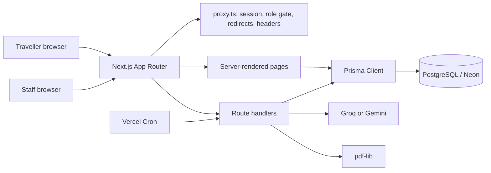
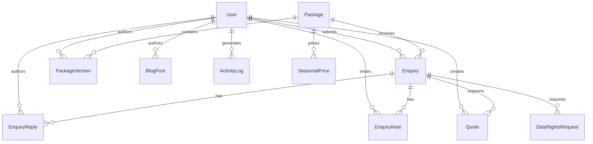
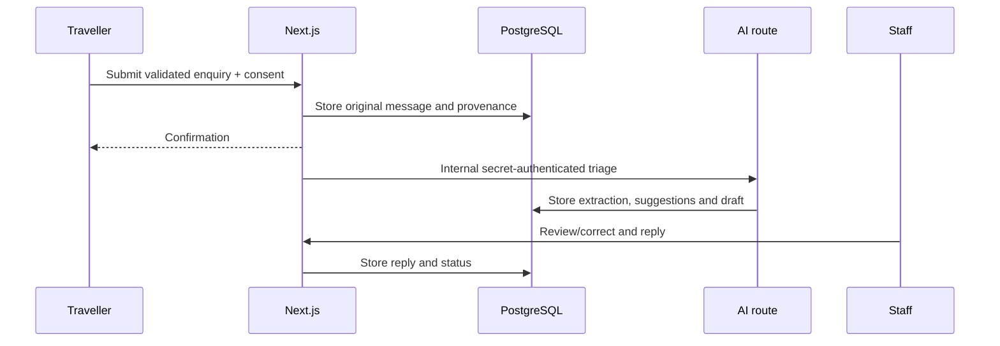

# Itera technical design document

- **GitHub:** https://github.com/vaishnavi-eklaspur/itera
- **Live app:** https://itera-5nq4.vercel.app
- **Submission repository:** this document, [deployment.md](deployment.md) and
  [README.md](README.md)

## 1. Product and scope

Itera is the working core slice for Company A, a Kochi-based tour operator.
The core outcome is that a traveller can discover a package and submit an
enquiry, while staff can update packages, review AI-assisted enquiry data and
reply from one inbox.

The implemented scope is intentionally narrower than a full agency platform:

1. Public, server-rendered package discovery and detail pages.
2. Versioned package CMS with seasonal pricing and preview.
3. Enquiry intake, AI extraction, deterministic suggestions and staff reply.
4. Authentication, RBAC, seeded realistic data and tests.

Additional depth includes blogs, quotes, consent controls, retention,
redirects, sitemap, robots, activity logging and PDF generation.

### Requirements versus assumptions

| Type | Decision |
|---|---|
| Original requirement | English first; Hindi and German are deferred |
| Original requirement | Payments, live inventory and native apps are out of scope |
| Original requirement | Outside messaging systems may be mocked |
| Additional feature | The product brief's Traveller and Staff Admin roles were expanded to Admin, Editor, Consultant and Traveller roles |
| Additional feature | Public package discovery includes keyword/destination, duration, budget, hotel-tier and season filters, plus price/duration/popularity sorting |
| Assumption | PostgreSQL is hosted on Neon for the Vercel demo |
| Assumption | Prices are INR, per person, twin sharing, with GST treatment stored per price |
| Assumption | A package photo can be represented by a trusted HTTPS URL in the demo |
| Assumption | “Within an hour” is represented by status/response-time UI; no SLA worker sends reminders |
| Assumption | The 140 redirects are a realistic simulated URL set from the brief, not Company A's actual legacy URL export |
| Limitation | Vercel package publishing is scheduled daily; a package may publish up to 24 hours after its scheduled time |
| Limitation | Production mobile Slow 4G Lighthouse performance is not yet verified |

## 2. Architecture

Next.js 16 App Router keeps public routes server-rendered for clean URLs,
metadata, sitemap coverage and a small client JavaScript surface. Prisma gives
typed access to PostgreSQL and transactions. The proxy is a first gate, not a
replacement for route-level authorization: mutation handlers call `auth()` and
role checks independently.

## 3. Data model

Important entities:

- `User`: credentials, role and contact details.
- `Package`: stable slug/status/current version and schedule.
- `PackageVersion`: append-only title, destination, itinerary, inclusions,
  exclusions, photos and map data.
- `SeasonalPrice`: month range, per-person price, basis and GST flag.
- `Enquiry`: original message, channel, consent provenance, extracted JSON,
  suggestions, draft reply, status and assignment.
- `EnquiryReply`/`EnquiryNote`: staff workflow history.
- `BlogPost`: Markdown-compatible content, SEO fields and related package IDs.
- `Quote`: database-selected price, GST calculation, validity, public token and
  branded PDF endpoint.
- `DataRightsRequest` and `ActivityLog`: privacy operations and accountability.

Package edits and price replacement occur in Prisma transactions. Restoring a
version creates a new version instead of mutating history.

## 4. Main flows

### Traveller enquiry

AI extraction is Zod-validated. Matching is deterministic: destination,
budget, dates and group size are scored from database package data. The draft
can contain only prices read from `SeasonalPrice`; staff must edit/approve it
before sending. If providers are unavailable, a bounded fallback extraction
keeps the enquiry usable and visibly leaves staff in control.

### Package publishing

An Admin or Editor creates a package, adds itinerary and prices, previews it,
then publishes or schedules it. Each edit creates a version. Public routes read
the current published version only; preview uses a short-lived preview token.

### Quotes

Admin or Consultant selects a package, travel date and traveller count. The
server resolves the active seasonal price for that date, calculates GST and
stores a quote. A tokenized public page and `/api/quotes/[token]/pdf` provide
the link and PDF. The client cannot choose an arbitrary price.

## 5. UI and design

The visual system uses warm neutrals, restrained forest green, editorial
headings and clear sans-serif body text. Public pages use full-width travel
photography, whitespace and one primary Enquire CTA. Admin screens use the
same palette with compact tables and explicit labels so an editor can change a
package without training.

Key screens:

- **Package list/detail:** mobile-first cards with URL-backed keyword,
  destination, duration, budget, hotel-tier and season filters; price, duration
  and popularity sorting; plus itinerary, map, gallery, prices and estimator.
- **Package editor:** structured itinerary, seasonal price rows, photo URLs,
  preview and version history.
- **Enquiry inbox/detail:** original message beside editable extracted fields,
  suggestions, draft reply, assignment, notes and consent status.
- **Blog editor:** visual `contentEditable` surface with formatting controls;
  saved content remains Markdown-compatible.
- **Quote page/PDF:** verified package price, basis, GST, validity and CTA.

Loading, empty and error states are present in public and admin flows. Real
external integrations are not represented as fake success: email delivery is
logged server-side and staff-entered channel records are explicit.

## 6. Security and privacy

- bcrypt password hashes and NextAuth httpOnly session cookies.
- Zod validation on mutations; Prisma parameterized queries.
- Proxy and route-level RBAC with Admin, Editor, Consultant and Traveller roles.
- Internal AI and cron routes use secret headers.
- Login and public mutation endpoints use IP-based sliding-window limits and
  return `429` with `Retry-After`.
- Consent records store timestamp, source and version; WhatsApp follow-up
  requires active consent.
- Correction requests require structured allowlisted data before completion.
- Deletion uses an atomic transaction to anonymize linked enquiry, reply, note,
  quote, user, request and linked activity-log details.
- Retention cron anonymizes closed enquiries after `ENQUIRY_RETENTION_DAYS`
  (default 730).
- Package publishing and retention cron handlers fail closed unless the
  configured `CRON_SECRET` bearer token is supplied.
- CSP, frame, MIME, referrer and permissions headers are set in `proxy.ts`.
  A spot check of one deployed package detail page found no CSP violations;
  it did show an aborted image request and an unused image-preload warning.
  This does not establish clean-console behavior across all routes.

## 7. API surface

| Area | Representative routes |
|---|---|
| Public | `GET /api/packages`, `GET /api/packages/[slug]`, `POST /api/enquiries` |
| Auth | NextAuth credentials callback and registration |
| Admin packages | `/api/admin/packages/*` |
| Admin enquiries | `/api/admin/enquiries/*` |
| Admin blog | `/api/admin/blog/*` |
| Quotes | `POST /api/admin/quotes`, `GET /api/quotes/[token]/pdf` |
| Data rights | `/api/me/data-rights`, `/api/admin/data-rights` |
| Internal | `POST /api/internal/ai` |
| Scheduled | `/api/cron/retention`, `/api/cron/publish` |

## 8. Testing and verification

The repository uses Vitest. On 2026-11-09, the local worktree passed all 83
tests, `npx tsc --noEmit`, and `npm run build`. ESLint reported zero errors and
19 warnings, primarily existing image and navigation recommendations. Tests
include focused cases for package-search query construction, Markdown safety
and round-tripping, data-rights transactions, and cron authorization.

The following are not claimed as complete:

- deployed Mobile Slow 4G Lighthouse threshold;
- clean-console verification across every deployed route;
- end-to-end mutation tests against a disposable production-like database;
- distributed rate-limit behaviour across multiple serverless instances.

## 9. What was cut and next steps

Cut or mocked: live email/WhatsApp, online payments, hotel/flight inventory,
image uploads, multi-language content, full-text search infrastructure,
pagination at large scale, real-time notifications and conversion analytics.

Next engineering steps, in order:

1. Measure and tune the deployed Mobile Slow 4G target.
2. Verify browser console and external asset behavior across public and staff routes.
3. Move rate limiting to a shared store.
4. Add end-to-end privacy and quote tests using an isolated database.
5. Add real delivery providers, uploads, pagination and conversion analytics.
